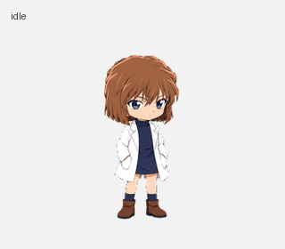

# Codex Sherry · 灰原哀桌面宠物

为 Codex / ChatGPT 桌面宠物制作的灰原哀风格动画素材与处理脚本。新版统一了茶棕短发、蓝眼睛、白大褂和深蓝服装，使用较小的连续动作，减少状态切换时的比例跳变和突然换姿势。



## 下载与使用

最终透明精灵图：[assets/sherry.png](assets/sherry.png)。规格为 **1536 × 2288、8 列 × 11 行、每格 192 × 208，共 73 帧（v2）**。

在支持自定义宠物 v2 精灵图的客户端中，通过宠物设置的上传／导入入口选择这张 PNG，然后启用。如果由 Codex 管理宠物，可让它使用 `work-pets:update-pet` 技能，校验这张图片并更新你指定的自定义宠物。

客户端决定动作的触发、循环次数和播放速度。系统“减少动态效果”会影响动画播放；制作时使用的桌面客户端还会将空闲帧时长放慢至基础参数的六倍。不同客户端版本可能有差异。

## 动作与状态

| 行（从 0 开始） | 状态 | 帧数 | 动作 |
| --- | --- | ---: | --- |
| 0 | idle | 6 | 轻微呼吸、眼睑变化 |
| 1–2 | running-right / running-left | 各 8 | 拖动时的左右移动 |
| 3 | waving | 4 | 小幅抬手问候 |
| 4 | jumping | 5 | 悬停小跳，准确落回原基线 |
| 5 | failed | 8 | 皱眉、低头后恢复 |
| 6 | waiting | 6 | 轻轻摊掌，等待输入 |
| 7 | running | 6 | 站立托腮思考 |
| 8 | review | 6 | 查看、轻微点头 |
| 9–10 | look directions | 各 8 | 顺时针 16 个观察方向 |

观察方向从向上 `000°` 开始，顺时针每次增加 `22.5°`。它们供客户端相应交互调用，具体触发由客户端决定。

[空闲实际节奏](previews/idle-client-timing.gif) · [空闲到小跳](previews/idle-jump-idle.gif) · [转头方向](previews/look-loop.gif) · [MP4 演示](previews/all-states.mp4)

## 本地校验与预览

使用 Python 3.11 或更高版本：

```bash
python -m venv .venv
# Windows PowerShell
.\.venv\Scripts\Activate.ps1
python -m pip install -r requirements.txt
python scripts/verify.py
python scripts/render_previews.py --output-dir .cache/previews
```

`verify.py` 检查发布文件的 SHA-256、尺寸、透明通道和 73 个有效单元格布局。它用于下载完整性与布局检查；制作阶段的完整质量校验结果保存在 `validation/`。

`render_previews.py` 直接读取最终 PNG，生成九组动作 GIF、全状态 GIF/MP4、空闲到小跳过渡及方向循环。预览用来依次展示动作，实际客户端可能只播放有限次后回到空闲。

## 制作脚本与提示词

```text
assets/                   最终透明素材
previews/                 精选动画和静态预览
scripts/                  校验、预览和制作辅助脚本
prompts/                  已使用的最终图像生成提示词
validation/               发布清单及制作质量记录
Library/                  本地完整制作归档（Git 忽略）
```

图片使用内置 `image_gen` 工具生成；Python 负责像素提取、统一配准、拼图、预览和验证。完整重建还需要原始行图、参考图和提取帧。它们保存在本机制作归档中，仓库只保留最终交付所需内容。

`register_frames.py` 和 `check_final.py` 是从本次制作过程整理出的辅助脚本，需指定完整制作目录；后者调用已安装的 work-pets 官方技能脚本：

```bash
python scripts/register_frames.py --run-dir /path/to/full-run
python scripts/check_final.py --run-dir /path/to/full-run --skill-dir /path/to/create-pet/scripts
```

省略 `--skill-dir` 时，可通过 `WORK_PETS_SCRIPT_DIR` 指定，或从 `CODEX_HOME`（默认 `~/.codex`）下的 work-pets 安装目录发现。技能脚本随插件提供。

## 已完成的验证

- v2 尺寸、透明背景、有效帧及空白格检查通过。
- 动作质量检查通过；小跳抬升 13 px，落地基线误差 0 px。
- 16 个方向经过语义检查及三份独立盲审，方向校验通过。
- 上传预检通过；服务端回读图片的全部 RGBA 像素与最终版一致。PNG 存储编码可能不同。
- 制作时已确认客户端缓存读取 v2；桌面实时播放未作为自动化 UI 验收。

质量记录保留了一项 `157.5° → 180°` 相邻帧差异指标提示；已目检该处转头边界，身体尺寸和脚底基线稳定。参见 [validation/quality.json](validation/quality.json)。

代码许可沿用仓库现有 [MIT License](LICENSE)。
